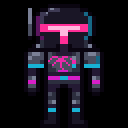

<p align="center">
  
</p>
<p align="center"><em>A world bible for game writers: entries, links and lore, all on the grid.</em></p>

# Open Lore


Game world bible — structured worldbuilding with graph relationships.

## Features

- **Entry types** — characters, locations, factions, items, events, creatures, concepts, notes
- **Markdown editor** — rich content with title, tags, and custom properties
- **Bidirectional links** — typed relationships (ally of, located in, member of, etc.) with automatic backlink tracking
- **Properties system** — custom key-value metadata per entry (race, age, alignment, etc.)
- **Tag & search** — full-text search across titles, content, and tags
- **Type filtering** — sidebar with per-type counts and one-click filtering
- **Project library** — manage multiple worlds, each saved as JSON
- **Export** — copy full world JSON to clipboard for backup or sharing
- **Dangling link cleanup** — deleting an entry automatically removes all links pointing to it

## Tech Stack

- **Flutter** (cross-platform: Linux, macOS, Windows, web)
- **JSON file storage** — worlds saved to `~/.openlore/worlds/`
- **Graph data model** — entries + typed directional links with backlink resolution

## Getting Started

```bash
flutter pub get
flutter run -d linux
```

## Build

```bash
flutter build linux --release
```

Binary lands in `build/linux/x64/release/bundle/open-lore`.

## License

MIT

---

## Credits


*This is the wave. 🎹🦈🌆*

---

## ☕ Support the Developer

If this project saved you time, solved a problem, or just made your day a little more neon, you can fuel the next one:

[](https://buymeacoffee.com/synthalorian)

---

<p align="center">
  <br>
  <sub>Built by <a href="https://github.com/synthalorian">the synthalorian</a></sub>
  <br><sub>AI-assisted art: the banner image at the top of this README was made with AI image tools. The synthalorian sprite is code-drawn pixel art.</sub>
</p>
